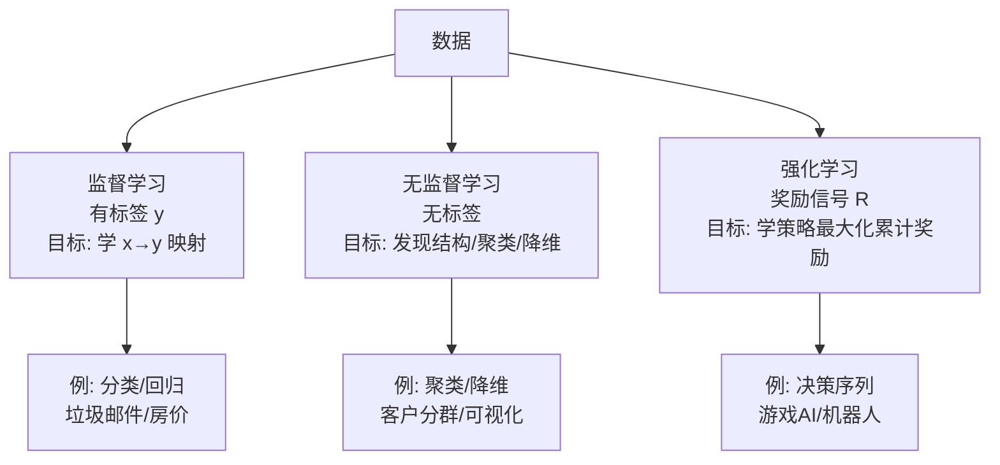

# 01 机器学习概述

> 来源：黑马《机器学习宝典》开篇
> 重点：建立对「什么是 ML / 为什么用它 / 怎么用」的直觉。

## 1.1 什么是机器学习

- 定义（Samuel / Mitchell 版）：**从数据中自动学习规律，无需显式编程即可得到能对新数据做预测/决策的模型**。
- 与传统编程的区别：
  ```
  传统：  输入 + 规则  →  输出
  机器学习：输入 + 输出  →  规则（模型）
  ```
- 本质：用**数据**驱动，让算法自己从经验（数据）中改进性能。

## 1.2 主要分类

### 按学习方式
| 类型 | 是否有标签 | 典型任务 | 例子 |
|------|-----------|----------|------|
| 监督学习 Supervised | 有 | 分类、回归 | 垃圾邮件识别、房价预测 |
| 无监督学习 Unsupervised | 无 | 聚类、降维、密度估计 | 客户分群、可视化 |
| 半监督 Semi-supervised | 少量标签 | 介于两者之间 | 网页分类 |
| 强化学习 RL | 奖励信号 | 决策序列 | 游戏 AI、机器人控制 |

### 按预测目标
- **分类（Classification）**：输出离散类别（二分类 / 多分类）。
- **回归（Regression）**：输出连续数值。
- 注意：逻辑回归名字带「回归」但做的是**分类**。

## 1.3 机器学习开发流程（黑马总结的范式）

1. 获取数据（原始数据）
2. 数据基本处理（清洗、缺失值、异常值）
3. 特征工程（提取、构造、选择、缩放）—— **往往比选模型更影响效果**
4. 选择合适的算法模型训练
5. 模型评估（准确率 / 误差 / 业务指标）
6. 调参（超参搜索、交叉验证）
7. 上线部署 + 监控迭代

## 1.4 关键术语速查

- **样本 / 实例（sample）**：一条数据；**特征（feature）**：输入变量；**标签（label）**：目标变量。
- **训练集 / 验证集 / 测试集**：训练用 / 调参用 / 最终评估用，三者不可混用。
- **泛化能力（generalization）**：模型对未见过数据的表现，是终极目标。
- **过拟合 / 欠拟合**：见 `04-模型评估与选择.md`。
- **模型容量（capacity）**：模型拟合复杂函数的能力，与过/欠拟合直接相关。

## 1.5 常见误区

- 准确率（accuracy）高 ≠ 模型好（类别不平衡时失效，见 `04` 的评估指标）。
- 测试集泄漏（data leakage）：训练时偷偷用到了测试信息，导致线上崩。
- 把验证集当训练集反复调参 → 变相过拟合测试集。

---

### 1.3.1 三种学习范式对比图


- 监督：x + y → 规则；无监督：x → 结构；强化：动作 → 奖励 → 策略。
- 半监督介于监督/无监督之间（少量标签 + 大量无标签）。
