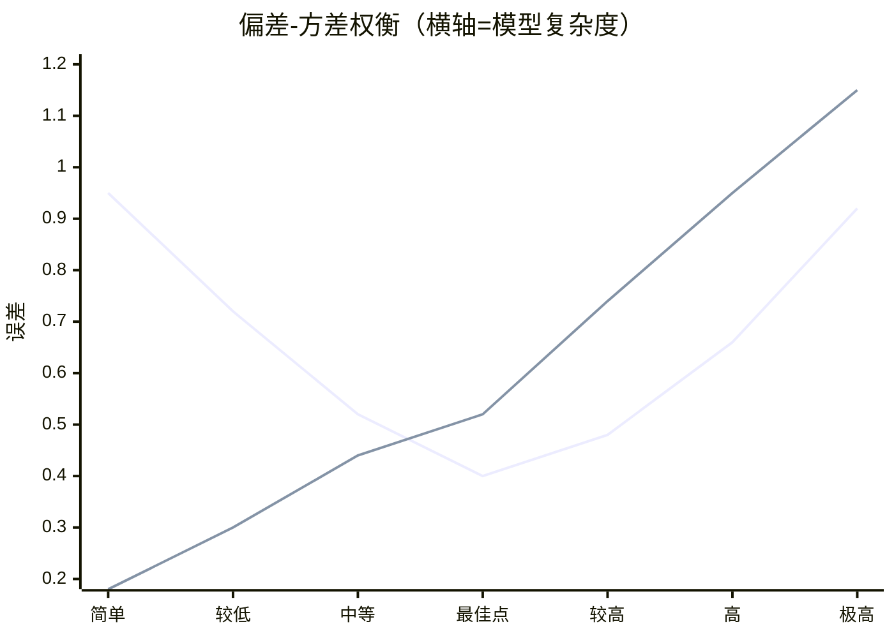

# 04 模型评估与选择

> 来源：黑马评估章节 + 吴恩达 Course 3（结构化 ML 项目）
> 重点：怎么判断模型好坏、怎么诊断过/欠拟合、怎么排错。

## 4.1 数据集划分

- **训练集（Train）**：学参数。
- **验证集（Dev / Val）**：调超参、选模型。
- **测试集（Test）**：只用于**最终一次性**报告性能，绝不参与训练/调参。
- 划分比例：经典 60/20/20 或 70/15/15；大数据时可 98/1/1（测试集够大即可）。
- **分层抽样**：尤其类别不平衡时，保证各集类别比例一致。
- **交叉验证**见 4.3；分布一致性见 4.6。

## 4.2 偏差与方差（Bias-Variance）

- **偏差高 = 欠拟合**：训练误差都大，模型太简单。
- **方差高 = 过拟合**：训练误差小、验证误差大，模型「背」了训练集。
- 总误差 ≈ 偏差² + 方差 + 不可约噪声。两者存在权衡（trade-off）。

| 现象 | 训练误差 | 验证误差 | 诊断 |
|------|----------|----------|------|
| 欠拟合 | 高 | 高 | 高偏差 |
| 过拟合 | 低 | 高 | 高方差 |

### 4.2.1 偏差-方差权衡示意图

横轴 = 模型复杂度，纵轴 = 误差。训练误差随复杂度单调下降，验证误差呈「U 形」——先降后升，谷底即最佳复杂度。


- 上线（U 形）= 验证/测试误差：左端高 = 欠拟合(高偏差)，右端高 = 过拟合(高方差)，谷底最佳。
- 下线（单调降）= 训练误差：越复杂越能「记住」训练集。
- 两线间隙 = 方差；训练线高度 = 偏差。

> 若 mermaid 图表在你的预览里仍不显示，下面文字版给出同样结论：

```text
误差
1.2 |                                          ╱  验证误差 (U形)
    |                                     ╱
    |                                ╱
0.9 |                           ╱             ╲
    |                      ╱                     ╲
0.6 |                 ╱                             ╲___
    |            ╱  训练误差 (单调下降)
0.3 |_______╱
    +------------------------------------------------→ 模型复杂度
    简单          最佳点(谷底)                 复杂
```
左端两线都高 = 高偏差(欠拟合)；谷底最佳；右端验证线回升、间隙变大 = 高方差(过拟合)。

## 4.3 交叉验证（Cross Validation）

- **k 折交叉验证**：把训练集分 k 份，轮流留 1 份验证，取平均。
- 用途：数据少时更稳健地估计泛化误差、选超参。
- **留一法（LOO）**：k=m，极稳但极慢。
- **分层 k 折**：分类任务保持每折类别比例。

## 4.4 评估指标

### 回归
- **MSE** $\frac{1}{m}\sum(\hat{y}-y)^2$（平方放大离群点）；
- **RMSE**（开方，回到原量纲）；
- **MAE** $\frac{1}{m}\sum|\hat{y}-y|$（对离群点稳健）；
- **$R^2$**：解释方差比例，$1-\frac{\sum(y-\hat{y})^2}{\sum(y-\bar y)^2}$（=1 完美，=0 等于均值预测，<0 比均值还差）。

### 分类（逐指标详述）

设二分类混淆矩阵：

| 真实 \ 预测 | 正类(+) | 负类(−) |
|------|----------|----------|
| 正类(+) | TP（真阳） | FN（假阴/漏报） |
| 负类(−) | FP（假阳/误报） | TN（真阴） |

| 指标 | 公式 | 取值 | 最好 | 最坏 | 说明 |
|------|------|------|------|------|------|
| **准确率 Accuracy** | $(TP+TN)/(P+N)$ | $[0,1]$ | 1（全对） | 0（全错） | 仅**类别平衡**时有意义；不平衡时「全预测多数类」也能很高 |
| **错误率 Error** | $1-$Accuracy | $[0,1]$ | 0 | 1 | 准确率的补集 |
| **精确率 Precision (P)** | $TP/(TP+FP)$ | $[0,1]$ | 1（预测为正的**没有**误报） | 0（全误报） | 「预报的正例里有多少真对」；关注**误报代价高**时（如垃圾邮件判错正常邮件） |
| **召回率 Recall (R) / 灵敏度 TPR** | $TP/(TP+FN)$ | $[0,1]$ | 1（正例**一个不漏**） | 0（全漏报） | 「真实正例里找出多少」；关注**漏报代价高**时（如癌症筛查） |
| **特异性 Specificity (TNR)** | $TN/(TN+FP)$ | $[0,1]$ | 1 | 0 | 「真实负例里正确排除多少」；与召回对称 |
| **F1 分数** | $2PR/(P+R)$ | $[0,1]$ | 1（P、R 都高） | 0（任一为 0） | P 与 R 的**调和平均**，对两者都低更敏感；不平衡时比准确率诚实 |
| **Fβ 分数** | $(1+\beta^2)PR/(\beta^2P+R)$ | $[0,1]$ | 1 | 0 | $\beta>1$ 偏重召回，$\beta<1$ 偏重精确率 |
| **负预测值 NPV** | $TN/(TN+FN)$ | $[0,1]$ | 1 | 0 | 「预报负例里真为负的比例」 |
| **假发现率 FDR** | $FP/(FP+TP)$ | $[0,1]$ | 0 | 1 | 精确率的反面 $=1-P$ |
| **ROC 曲线 / AUC** | 横轴 FPR=$FP/(FP+TN)$，纵轴 TPR=Recall；AUC=曲线下面积 | AUC $\in[0,1]$ | 1（完美排序） | 0.5（等于随机；<0.5 说明标签反了） | **阈值无关**的综合排序能力；AUC=0.5 即随机，>0.8 较好 |
| **PR 曲线 / AP** | 横轴 Recall、纵轴 Precision；AP=面积 | AP $\in[0,1]$ | 1 | 0 | **正类稀少**时比 ROC 更诚实（ROC 在大 TN 下被「撑高」） |
| **对数损失 LogLoss** | $-\frac1m\sum[y\log\hat p+(1-y)\log(1-\hat p)]$ | $[0,\infty)$ | 0（预测概率=真实） | $\infty$（把 1 判成 0） | 衡量**概率校准**好坏，不只看硬分类 |
| **Cohen's κ** | $(\text{Acc}-p_e)/(1-p_e)$，$p_e$ 为随机一致率 | $[-1,1]$ | 1（完全一致） | <0（比随机还差） | 扣除「瞎猜也能碰对」后的真实一致度，标注/模型对比常用 |
| **马修斯相关系数 MCC** | $(TP\cdot TN-FP\cdot FN)/\sqrt{(P+\dots)(N+\dots)}$ | $[-1,1]$ | 1 | −1（全错）/0（随机） | 不平衡下比 F1 更全面（综合全部四类） |
| **平衡准确率** | $(TPR+TNR)/2$ | $[0,1]$ | 1 | 0 | 各类召回的平均，不平衡友好 |

- **多分类**：宏平均（每类算指标再平均，小类也平等）/ 微平均（先汇总 TP/FP 再算，被大类主导）/ 加权平均（按样本数加权）。
- **mAP（mean Average Precision）**：目标检测/检索里对每个类别算 AP 再平均（见 `11`）。

> 取值与好坏的通用判断：**率类指标（P/R/F1/AUC/AP/κ/MCC）越大越好，上界 1（或 κ/MCC 上界 1）**；**损失类（LogLoss/MSE）越小越好，下界 0**；**「最好/最坏」要结合业务代价**——漏诊（FN 高）和误诊（FP 高）哪个更不能接受，决定你优先优化 R 还是 P。

## 4.5 正则化（控制过拟合的总手段，详见 `05`/`10`）

- L2（岭）：惩罚 $\|\mathbf{w}\|_2^2$；L1（Lasso）：惩罚 $\|\mathbf{w}\|_1$（稀疏，见 `02`）。
- 数据增强、Dropout、Early Stopping、BatchNorm（深度学习，见 `10`）。

## 4.6 吴恩达 Course 3：结构化 ML 项目（实战策略）

### 误差分析（Error Analysis）
- 手动检查**验证集**里出错的样本，统计各类错误占比，优先修「占比高且可行」的方向。
- 不要凭直觉拍脑袋决定加哪个特征。
- 可建**误差分析表**（每列一种错误类型，逐样本打勾），量化优先级。

### 训练/验证/测试分布要一致
- 若验证集与测试集分布不同，A/B 模型在验证集的胜负**不能**代表测试集。
- 可设「训练-验证划分」与「纯测试划分」两套，分离「拟合能力」与「分布偏移」。

### 偏差/方差的「可避免偏差」视角
- 人类水平误差（贝叶斯误差近似）作基准：
  - 训练误差 − 人类误差 = **可避免偏差**（高则加模型容量）；
  - 验证误差 − 训练误差 = **方差**（高则正则化/更多数据）。
- 三者关系：**最优误差（贝叶斯）≤ 可避免偏差 ≤ 方差** 共同构成总误差。

### 数据不匹配（Data Mismatch）
- 训练数据分布 ≠ 部署数据分布时的处理：做「训练-验证」集（来自训练分布）和「测试-验证」集（来自真实分布），分别诊断。
- 人工合成数据要谨慎（可能过拟合到合成特性，如只加一种噪声）。

### 迁移学习 / 多任务学习 / 端到端
- **迁移学习**：大数据源预训练 → 小数据目标任务微调（如 ImageNet → 医疗影像）；通常替换/重训最后几层。
- **多任务学习**：一个模型同时学多个相关任务（共享底层表示），任务间数据分布相似、且能共享低层特征时有效。
- **端到端**：直接用原始输入到输出，避免人工中间表示（前提是数据/算力足够，否则分阶段更稳）。

### 单实数评估指标 + 优化/满足指标
- **优化指标**（Optimizing）：要最小化的单一数字（如准确率）。
- **满足指标**（Satisficing）：达标即可的约束（如「推理延迟 < 100ms」），满足后只比优化指标。
- 多指标时把它们合并为一个「单实数」便于快速排序模型。
