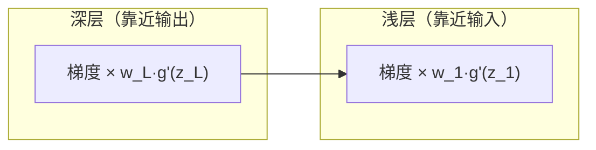

# 09 神经网络与深度学习基础

> 来源：吴恩达 Deep Learning Specialization — Course 1（Neural Networks and Deep Learning）
> 重点：从逻辑回归到深层网络、前向/反向传播、激活函数。

## 9.1 为什么需要「深度」网络

- 浅层网络表达力有限；深层网络可**逐层组合**简单特征 → 复杂特征（边缘→纹理→部件→物体）。
- 深层网络的参数量相对输入维度更可控，且在不同尺度上复用特征。

## 9.2 逻辑回归 → 单神经元

- 一个神经元 = 线性组合 + 非线性激活：$a=\sigma(\mathbf{w}^T\mathbf{x}+b)$。
- 这就是 `06` 的逻辑回归单元；把它堆叠起来就是神经网络。

## 9.3 网络结构记号（务必记熟）

- 第 $l$ 层神经元数 $n^{[l]}$；总层数 $L$（输入层不算）。
- 权重 $W^{[l]}\in\mathbb{R}^{n^{[l]}\times n^{[l-1]}}$，偏置 $b^{[l]}\in\mathbb{R}^{n^{[l]}}$。
- 线性部分 $Z^{[l]}=W^{[l]}A^{[l-1]}+b^{[l]}$；激活 $A^{[l]}=g^{[l]}(Z^{[l]})$（$g$ 为激活函数）。
- 约定：$A^{[0]}=X$（输入），$A^{[L]}=\hat{Y}$。

## 9.4 激活函数（Activation Functions）

| 激活 | 公式 | 优点 | 缺点 | 使用层 |
|------|------|------|------|--------|
| Sigmoid | $1/(1+e^{-z})$ | 输出 (0,1)，适合二分类输出层 | 饱和区梯度≈0（梯度消失）、非零中心 | 输出层（二分类） |
| Tanh | $(e^z-e^{-z})/(e^z+e^{-z})$ | 零中心、收敛快于 sigmoid | 仍有饱和梯度消失 | 隐藏层（旧） |
| ReLU | $\max(0,z)$ | 计算快、缓解梯度消失、稀疏 | 死亡 ReLU（负区永久 0） | **隐藏层默认首选** |
| Leaky ReLU / ELU | 负区给小斜率 | 缓解死亡 ReLU | 多一个超参 | 隐藏层备选 |
| Softmax | $e^{z_i}/\sum_j e^{z_j}$ | 多分类输出概率和为 1 | — | 输出层（多分类） |

> 关键结论：**隐藏层几乎都用 ReLU 系**；sigmoid/softmax 主要留在输出层。

## 9.5 前向传播（Forward Propagation）

逐层算 $Z^{[l]}=W^{[l]}A^{[l-1]}+b^{[l]}$，$A^{[l]}=g^{[l]}(Z^{[l]})$，直到输出层得到 $\hat{Y}$，再算损失。

### 9.5.1 权重矩阵的含义：为什么从向量变成矩阵

> 直觉：线性回归的 $w$ 是一**套评价标准**（给一个西瓜的综合品质打分）；深度学习里 $W$ 是把**多套评价标准并排**打包的矩阵，每列对应一个神经元 / 一个输出单元。

- **线性回归：单输出，权重是列向量**。$\hat y=w^Tx+b$，$w\in\mathbb{R}^{d\times1}$，$w_i$ 是第 $i$ 个特征对输出的影响权重。输出**一个数**。
- **多输出 / 多分类：权重自然变成矩阵**。若要同时输出 $K$ 个数（如 $K$ 个类别的得分），每个输出有自己的权重向量 $w_k\in\mathbb{R}^{d\times1}$，并排成
  $$W=\bigl[w_1,\;w_2,\;\cdots,\;w_K\bigr]\in\mathbb{R}^{d\times K},\qquad z=W^Tx+b\;(z\in\mathbb{R}^{K})$$
  - 框架常用行向量约定：$X\in\mathbb{R}^{n\times d}$（每行一个样本），$Z=XW+b$，$W$ 的**列**仍对应 $K$ 个输出神经元、**行**对应 $d$ 个输入特征，只是乘法顺序变了。
  - 矩阵元素 $W_{ik}$ = 第 $i$ 个输入对第 $k$ 个输出的连接强度；第 $k$ 列 $w_k$ 就是第 $k$ 个输出单元的权重向量。
- **神经网络一层 = $h$ 个神经元并行**。每个神经元做的事与线性回归几乎一样：$z_j=w_j^Tx+b_j$，再过激活 $a_j=g(z_j)$。把 $w_1,\dots,w_h$ 并排成 $W\in\mathbb{R}^{d\times h}$，整层 $z=W^Tx+b,\ a=g(z)$。隐藏层 $W$ 的「其他部分」不是额外数据，而是**其他神经元的权重向量**——每个神经元用一套权重从输入里**探测某一种模式**（如「又大又甜」「色泽鲜艳」）。
- **西瓜类比**（帮助理解多个 $w$）：
  - 一组 $w$ = 一套评价标准 → 给一个瓜打「综合品质分」；
  - 多组 $w$ = 多套评价标准 → 同时输出多个分（鲜食分 / 榨汁分 / 送礼分，各自看重不同指标）；
  - 多分类时每类一套 $w$ → 每个类算一个得分，再 softmax 成概率，回答「这个瓜有多像西瓜 / 哈密瓜 / 甜瓜」。
- **多层**：第 $l$ 层 $W^{(l)}\in\mathbb{R}^{d_{l-1}\times d_l}$，$W^{(l)}_{ij}$ = 第 $l-1$ 层第 $i$ 个神经元到第 $l$ 层第 $j$ 个神经元的连接权重；矩阵的列是下一层每个神经元的权重向量。

> 一句话：**一个 $w$ 是一套评价标准，输出一个数；多个 $w$ 是多套评价标准，同时输出多个数（类别得分 / 任务预测 / 隐藏层自动学出的特征）。矩阵只是把这些并排的权重向量打包，方便批量计算。**

### 9.5.2 偏置与齐次坐标：为什么深度学习通常保留独立的 $b$

> 你学线性回归 / SVM 时常把偏置 $b$ 吸收进权重（增广特征），但深度学习框架（如 `nn.Linear` 的 `weight` 和 `bias`）几乎都把它们分开。两者数学等价，但动机不同。

- **增广特征 / 齐次坐标**：令 $\tilde x=\bigl[x;\;1\bigr],\ \tilde w=\bigl[w;\;b\bigr]$，则 $w^Tx+b=\tilde w^T\tilde x$。传统 ML 常吸收 $b$：
  - 公式统一（所有仿射变换都写 $w^Tx$）；
  - 几何简洁（决策边界 $w^Tx+b=0$ 变成增广空间里过原点的超平面）；
  - 便于推导闭式解、对偶问题、核技巧、凸优化；
  - 参数合并成一个向量，更新更整齐。
- **但深度学习通常显式保留 $b$**，原因很实际：
  1. **模块化**：每层有独立 `weight`/`bias`，框架自动管理；吸收需手动给每层输入拼一列 1 再把 $b$ 拼进权重，多层时不直观。
  2. **正则化区别对待**：L2 权重衰减通常**只作用于 $W$、不作用于 $b$**（偏置只影响激活阈值，惩罚常无益甚至有害）。吸收进 $W$ 后 $b$ 也会被惩罚，改变优化目标。
  3. **初始化不同**：$W$ 用 Kaiming/Xavier 随机初始化，$b$ 通常初始化 0；合并后偏置被随机初始化，破坏初始动态。
  4. **优化器参数分组**：AdamW 等常把 $W$ 一组、$b$ 与归一化参数另一组，用不同的 weight decay / 学习率；合并后无法区分。
  5. **归一化层让偏置冗余**：接 BN/LN 时，归一化层自带 `beta` 偏置会抵消线性层的 `bias`，使其冗余；故很多 Transformer 的 Linear 直接 `bias=False`，由 LayerNorm 的 `beta` 充当偏置。
  6. **卷积结构不便**：卷积偏置是每输出通道一个；吸收需加常数通道、多一个输入通道，计算量增加且别扭。
  7. **非线性激活**：$b$ 影响激活阈值，不能跨层吸收到下一层，逐层保留更自然。
- **深度学习并非完全不吸收**，而是「按需吸收」：理论推导里写增广矩阵 $\tilde W\tilde x$；BN 的 `beta` 即偏置；推理时 **Conv-BN 融合**把 BN 缩放 / 平移吸进卷积；Transformer 用 LayerNorm 的 `beta` 当偏置（Linear `bias=False`）；算子融合时偏置常被吸进前一个线性变换。
- **数学等价 ≠ 优化等价**：即使无正则时 $w^Tx+b$ 与 $\tilde w^T\tilde x$ 等价，有 L2 正则会被一起惩罚，且不同的参数化使 SGD 梯度轨迹、噪声、初始化影响都不同；分开参数更易控制、调试、复用。

> 一句话：**教程吸收 $b$ 是为了公式简洁（理论记号），深度学习保留独立 $b$ 是为了工程灵活（模块化、可控正则、分组优化）。**

## 9.6 损失函数与代价函数

- 二分类：$L(\hat{y},y)=-(y\log\hat{y}+(1-y)\log(1-\hat{y}))$（交叉熵）。
- 多分类（softmax）：$\frac{1}{m}\sum_i -\log \hat{y}^{(i)}_{y^{(i)}}$（正确类的负对数概率）。
- 回归：MSE（但深层网络里 MSE 与激活搭配要小心）。

## 9.7 反向传播（Backpropagation）—— 核心中的核心

- 目标：用链式法则求 $J$ 对每一层 $W^{[l]},b^{[l]}$ 的梯度。
- 输出层误差：$\mathrm{d}Z^{[L]}=A^{[L]}-Y$（交叉熵 + softmax/sigmoid 的漂亮简化）。
- 逐层回传：
  $$\mathrm{d}W^{[l]}=\frac{1}{m}\,\mathrm{d}Z^{[l]}(A^{[l-1]})^T,\quad \mathrm{d}b^{[l]}=\frac{1}{m}\sum_i \mathrm{d}Z^{[l]}_{(i)}$$
  $$\mathrm{d}Z^{[l-1]}=(W^{[l]})^T\mathrm{d}Z^{[l]}\odot g'^{[l-1]}(Z^{[l-1]})$$
- 维度必须对齐：$W^{[l]}$ 与 $\mathrm{d}W^{[l]}$ 同形，这是 Debug 的利器。
- 更新：$W^{[l]}:=W^{[l]}-\alpha\,\mathrm{d}W^{[l]}$。

### 9.7.1 两层网络数值推导（1 隐藏层，验证维度）

设：$x\in\mathbb{R}^2$（$x=[0.5,0.3]^T$），隐藏层 1 个 sigmoid 神经元 $W^{[1]}=[0.4,0.6],b^{[1]}=0.1$，输出层 1 个 sigmoid 神经元 $W^{[2]}=[0.7],b^{[2]}=0$，标签 $y=1$。

**前向**：
- $z^{[1]}=0.4\cdot0.5+0.6\cdot0.3+0.1=0.48,\ a^{[1]}=\sigma(0.48)\approx0.619$
- $z^{[2]}=0.7\cdot0.619=0.433,\ \hat y=a^{[2]}=\sigma(0.433)\approx0.607$
- $L=-\log(0.607)\approx0.500$

**反向**（用 $\mathrm{d}z^{[L]}=a^{[L]}-y$ 与 $\sigma'=\sigma(1-\sigma)$）：
- $\mathrm{d}z^{[2]}=\hat y-y=-0.393$
- $\mathrm{d}W^{[2]}=(\hat y-y)\,a^{[1]}=-0.393\times0.619\approx-0.243$，$W^{[2]}\in\mathbb{R}^{1\times1}$ ✓
- $\mathrm{d}b^{[2]}=\hat y-y=-0.393$
- $\mathrm{d}a^{[1]}=(\hat y-y)\,W^{[2]}=-0.393\times0.7=-0.275$
- $\mathrm{d}z^{[1]}=\mathrm{d}a^{[1]}\odot\sigma'(z^{[1]})=-0.275\times(0.619\times0.381)\approx-0.065$
- $\mathrm{d}W^{[1]}=\mathrm{d}z^{[1]}\,(a^{[0]})^T=-0.065\times[0.5,0.3]=[-0.033,-0.020]$，$W^{[1]}\in\mathbb{R}^{1\times2}$ ✓
- $\mathrm{d}b^{[1]}=\mathrm{d}z^{[1]}\approx-0.065$

> 维度全部对齐：$W^{[l]}$ 与 $\mathrm{d}W^{[l]}$ 同形，这正是反向传播 Debug 的利器。框架的自动微分做的正是这件事。
### 9.7.2 梯度消失 / 爆炸：前向与反向两侧

- **前向（激活值）**：若每层权重 $\|\mathbf{w}\|\gg1$，激活值逐层指数放大 → 饱和（如 sigmoid 两端）→ 输出 NaN（爆炸的表象）；若 $\|\mathbf{w}\|\ll1$，激活值逐层趋 0（消失）。
- **反向（梯度）**：链式法则使梯度 = 各层导数连乘。深层时：
  - 多个 $<1$ 的导数连乘 → 梯度趋 0 → **梯度消失**（前层学不动，典型 sigmoid/tanh 深层）；
  - 多个 $>1$ 的因子连乘 → 梯度爆炸 → 参数震荡 NaN。

- **对策**：隐藏层用 ReLU 系（正区导数=1，不压缩）；良好初始化（He/Xavier）；BN；残差连接（见 `11`）；梯度裁剪（爆炸时）。

## 9.8 深度网络的向量化

- 整个 mini-batch 用矩阵一次算（不是 for 循环逐个样本）：列 = 样本。
- 向量化让 GPU 并行、速度提升几个数量级（见 `02` 练习）。

## 9.9 参数规模直觉

- 总参数量 ≈ $\sum_l (n^{[l]}n^{[l-1]}+n^{[l]})$；深层网络靠复用少量参数表达复杂函数。

## 9.10 广播（Broadcasting）机制

NumPy / 框架在运算时会**自动对齐形状**，避免显式复制数据：

- 规则（从尾部维度比对）：两数组维度**相等**，或**其中一个为 1**，或**其中一个不存在** → 可广播；维度为 1 的会沿该轴复制。
- 例：`(m, n) - (1, n)` → 第二维复制 $m$ 次；`(m, 1) + (n,)` → 各自扩展。
- 前向/反向里大量用到：`Z - Y`（`Z,Y` 同为 `(n,m)`）、`(W^{[l]}A^{[l-1]})` 与偏置 `b^{[l]}`（形状 `(n^{[l]},1)`）相加时，$b$ 沿样本轴广播。掌握广播能写出无 for 循环的清晰向量化代码。
- **坑**：形状差一位（如忘了 `keepdims`）会导致静默广播出错误形状 → 用 `np.reshape`/`keepdims=True` 明确维度，并用 `assert` 检查中间张量形状。

## 9.11 向量化与 Python/NumPy 技巧

- **永远优先向量化**：一次矩阵运算代替 for 循环逐个样本/特征，GPU 并行下快几个数量级（见 `02` 练习）。
- 避免 `for i in range(m):` 算梯度；用 `np.dot(W, X)`、`*` 逐元素、`np.sum(..., axis=1, keepdims=True)`。
- 逻辑回归向量化：$\hat Y=\sigma(W^TX+b)$、$dZ=\hat Y-Y$ 全样本一次算完。
- 用向量化版本与 for 循环版本对拍，确认数值一致（既是正确性也是性能保障）。

## 9.12 参数 vs 超参数

- **参数（Parameters）**：模型从数据中学到的，如 $W^{[l]},b^{[l]}$。
- **超参数（Hyperparameters）**：你**事先设定**的，如学习率 $\alpha$、层数 $L$、每层神经元数 $n^{[l]}$、激活函数、mini-batch 大小、正则化 $\lambda$、优化器 $\beta$。
- 超参数「套在参数外面」：参数由超参数控制的学习过程产出。调参 = 在开发集上选好的超参数（见 `10`/`04`）。

## 9.13 训练 / 开发 / 测试集（Course 1 基础视角）

- 数据划分为训练 / 开发（验证）/ 测试三份；训练学参数，开发选调，测试只做最终无偏报告（详细见 `04` 4.1 与 `10` 10.1）。
- 大数据时代训练集占比可很高；**训练集、开发集、测试集最好同分布**。
- 没有测试集也行（只保留训练/开发），但对外报告性能时测试集很重要。

## 9.14 随机初始化（浅层网络）

- 不能全零（对称权重 → 神经元学一样 → 失败，见 `10` 10.2）。
- 应**随机小初始化**：$W^{[l]}\sim \mathcal{N}(0,\sigma^2)$（如 0.01 量级），打破对称。
- 初始化太大 → 激活值饱和（sigmoid/tanh 两端梯度≈0）；太小 → 信号太弱。深层有专门的 He/Xavier 初始化（见 `10` 10.2）。

## 9.15 梯度检查（Gradient Checking，实现前向/反向时用）

- 用**数值差分**验证手写的反向传播是否正确（仅调试期用，不能和 Dropout/BN 混用）：
  $$\frac{\partial J}{\partial \theta_i} \approx \frac{J(\theta+\epsilon e_i)-J(\theta-\epsilon e_i)}{2\epsilon},\quad \epsilon\approx10^{-7}$$
- 比较解析梯度 $d\theta$ 与数值梯度 $d\theta_{num}$ 的**相对误差**：
  $$\frac{\|d\theta - d\theta_{num}\|_2}{\|d\theta\|_2+\|d\theta_{num}\|_2}$$
  应 < $10^{-7}$（数量级一致才算对；若 ~$10^{-3}$ 说明反向有 bug）。
- 只在训练前做一次健全性检查；正式训练时关掉（慢且对随机性层无效）。

## 9.16 为什么要用「深层」网络

- 浅层网络表达力有限；深层可**逐层组合**简单特征 → 复杂特征（边缘 → 纹理 → 部件 → 物体）。
- 深层网络的参数量相对输入维度更可控，且在不同尺度上复用特征（如 CNN 的层级特征，见 `11`）。
- 电路复杂度理论视角：某些函数用深层网络可用**指数级更少**的神经元表示；但深层带来梯度消失/爆炸、调参更难等新问题（对策见 `10`/`11`）。
