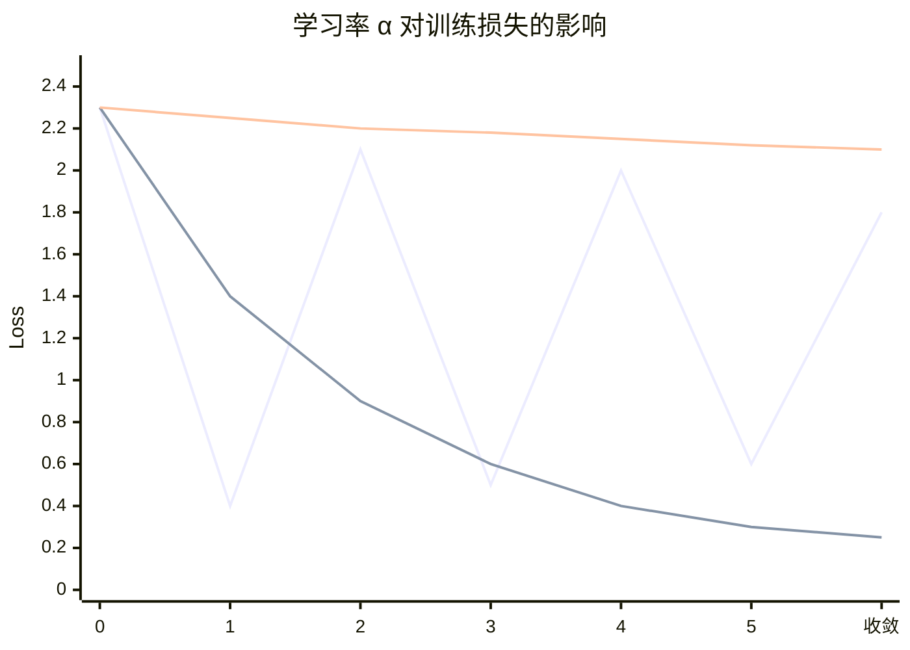

# 10 深度网络优化与超参调优

> 来源：吴恩达 Deep Learning Specialization — Course 2（Improving Deep Neural Networks: Hyperparameter Tuning, Regularization and Optimization）
> 重点：初始化、正则化、优化算法、批归一化、超参搜索、框架落地。
> 这是把「能跑的神经网络」变成「训得动、泛化好、好调参」的关键。

## 10.1 训练集 / 开发集 / 测试集

- 大数据时代：训练集可占 98%，开发/测试各 1% 也够（只要测试集大到能给出置信区间）。
- **分布一致原则**：开发集和测试集必须来自**同一分布**（你最终关心的数据）；否则开发集上「赢」的模型在测试集未必赢。
- **测试集可选**：若不需要对外报告无偏估计，有时只留训练/开发集即可。
- 经典比例 60/20/20 仅适用于「总样本很小（<1万）」的时代；数据大时训练集占比应很高。
- **偏差/方差诊断**（可避免偏差视角）见 `04` 4.6；本文件聚焦「怎么训好」。

## 10.2 权重初始化

- **全零初始化**：对称权重 → 所有神经元学一样 → 失败（必须打破对称）。
- **随机小初始化**：$W^{[l]}\sim \mathcal{N}(0,\sigma^2)$，配合 $1/\sqrt{n^{[l-1]}}$ 缩放避免激活值方差爆炸。
- **He 初始化**（配合 ReLU 系）：$W\sim \mathcal{N}(0,2/n^{[l-1]})$（fan-in）。
- **Xavier/Glorot 初始化**（配合 tanh/sigmoid）：$W\sim \mathcal{N}(0,2/(n_{in}+n_{out}))$。
- 目的：让每层的激活值与梯度方差在传播中大致稳定，缓解梯度消失/爆炸（见 `09` 9.7.2）。
- 偏置 $b$ 通常初始化为 0（不破坏对称性，因为 $W$ 已随机）。

## 10.3 正则化（对抗过拟合）

- **L2 权重衰减**：代价加 $\frac{\lambda}{2m}\sum\|W^{[l]}\|^2_F$（注意通常不惩罚偏置 $b$）。
  - 梯度多出一项 $\frac{\lambda}{m}W$，等效「每次更新把权重往 0 缩一点」。
  - 几何：约束参数到更小的球内，降低模型容量。
- **L1 正则**：加 $\frac{\lambda}{m}\sum|W|$，倾向产生稀疏权重（自动特征选择，见 `02`）。
- **Dropout**：训练时以概率 $p$ 随机「关闭」神经元；测试时**不**关闭但要乘以 $1-p$（或用 inverted dropout 在训练时缩放 $1/(1-p)$，测试不变）。
  - 直觉：强迫网络不依赖单一神经元，相当于**对子网络做集成**；对输入层也可做（输入丢弃 = 数据增强）。
  - 计算机视觉里尤其常用；**注意**：Dropout 与 BatchNorm、梯度检查不宜混用。
- **数据增强**（图像翻转/裁剪/变色、文本同义替换等）、**Early Stopping**（验证误差开始升就停，免费正则但耦合了优化与模型选择）。
- **权重约束**（如 max-norm）：把权重范数截断到上限，隐式正则。

> 正则化主要**降方差（过拟合）**；若高偏差（欠拟合），应先增大模型/训练更久，再谈正则。

## 10.4 优化算法（梯度下降家族）

### 10.4.0 三种梯度下降形态
| 方法 | 每步用多少数据 | 特点 | 适用 |
|------|----------|------|------|
| 批量 GD | 全训练集 | 稳但慢、占用内存大 | 小数据 |
| 随机 GD (SGD) | 单样本 | 快但噪声大、波动 | 极少直接用 |
| **Mini-batch GD** | 小批量（32/64/128/256） | **默认选择**，向量化+低噪 | 几乎所有场景 |

- mini-batch 大小 = 2 的幂（贴合 GPU 内存对齐）；越大越接近批量 GD（更稳更慢），越小越像 SGD（更噪更快探索）。
- **向量化**让一个 batch 用矩阵一次算完（见 `09` 9.8）。

### 10.4.1 指数加权平均（优化器基石）

很多优化器都建立在**指数加权平均（EMA）** 上：
$$v_t = \beta\,v_{t-1} + (1-\beta)\,\theta_t$$
相当于对序列 $\theta_t$ 做「遗忘因子 $\beta$ 的滑动平均」；窗口长度约 $1/(1-\beta)$（$\beta=0.9$ → 看约 10 步）。
**偏差修正**（冷启动 $v_0=0$ 会低估早期值）：
$$\hat v_t = \frac{v_t}{1-\beta^t}$$
前几步除以 $(1-\beta^t)$ 把它放大回真实量级；$t$ 大时 $(1-\beta^t)\to1$ 自动失效。Momentum/RMSprop/Adam 都用这套。

### 10.4.2 Momentum 与 Adam 更新公式

**Momentum**（指数加权平均梯度，模拟惯性， valley 里横向抵消、纵向累积 → 加速、减震荡）：
$$v_t = \beta_1 v_{t-1} + (1-\beta_1)\,g_t$$
$$\theta_t = \theta_{t-1} - \alpha\,v_t$$
（$\beta_1\approx0.9$。也可写作 $v_t=\beta_1 v_{t-1}+g_t$，等价只差一个常数因子。）

**RMSprop**（按梯度平方自适应缩放各参数学习率，抑制大幅度震荡的维度）：
$$s_t = \beta_2 s_{t-1} + (1-\beta_2)\,g_t^2$$
$$\theta_t = \theta_{t-1} - \frac{\alpha}{\sqrt{s_t+\epsilon}}\,g_t$$
（$\beta_2\approx0.999$。）

**Adam** = Momentum（一阶矩 $m_t$）+ RMSprop（二阶矩 $v_t$），并做偏差修正：
$$m_t = \beta_1 m_{t-1} + (1-\beta_1)\,g_t$$
$$v_t = \beta_2 v_{t-1} + (1-\beta_2)\,g_t^2$$
$$\hat m_t = \frac{m_t}{1-\beta_1^t},\quad \hat v_t = \frac{v_t}{1-\beta_2^t}$$
$$\theta_t = \theta_{t-1} - \alpha\,\frac{\hat m_t}{\sqrt{\hat v_t}+\epsilon}$$

- 一阶矩像「方向」、二阶矩像「每维自适应学习率」；$\epsilon\approx10^{-8}$ 防除零。
- **偏差修正很关键**：早期 $m_t,v_t$ 因 $(1-\beta)$ 很小而被低估，除以 $(1-\beta^t)$ 修正回真实量级；否则起步几步更新过小、训练变慢。
- Adam 是**最常用默认**；超参：学习率 $\alpha$（最重要）、$\beta_1\approx0.9$、$\beta_2\approx0.999$、$\epsilon\approx10^{-8}$。

### 10.4.2.1 动量法直觉：惯性、阻尼与偏差修正

> 把动量法拆成「算梯度（反向传播，含转置 / 外积）」和「用梯度更新参数（优化器，全程逐元素）」两步，分工清晰。

- **$v_{dW}$ 是速度（惯性）**：形状与 $W$ 完全相同，是过去所有梯度的**指数加权平均值（EMA）**；$\beta\approx0.9$ 决定「记忆长度」（$\beta$ 越大越依赖历史、当前梯度影响越小）。更新 $v_{dW}=\beta v_{dW}+(1-\beta)dW,\ W=W-\alpha v_{dW}$。
- **展开看「$v$ 蕴含了之前每一步的 $dW$」**（这就是 EMA 的本质）：
  $$v_t=(1-\beta)dW_t+\beta(1-\beta)dW_{t-1}+\beta^2(1-\beta)dW_{t-2}+\cdots$$
  越久远的梯度乘的 $\beta$ 次幂越多，权重指数衰减——故称「指数加权」。
- **为什么是 $(1-\beta)dW$ 防止震荡（阻尼）**：
  - 若没有 $(1-\beta)$ 缩放（写 $v=\beta v+dW$），当前剧烈震荡的梯度会直接「污染」历史动量，使 $v$ 也跟着震荡甚至发散；
  - 加上 $(1-\beta)$ 缩放（如 0.1）后，当前波动被压小：例如 $dW$ 在 $+100/-100$ 间震荡，缩放后只贡献 $\pm10$，速度只能在「温和」范围内改变。
  - 注意：数值上 $v$（占 $\beta=0.9$）是主导，$dW$（占 $1-\beta=0.1$）只是微调；但「只能微调、不能剧烈转向」正是因为 $(1-\beta)$ 在压制它。**惯性（$v$）提供平滑基础，阻尼（$(1-\beta)dW$）保证这个基础不被当前噪声破坏，两者缺一不可。**
- **更新全是元素级（element-wise）**：一旦 $dW$ 由反向传播算出来，后续的 $v_{dW}=\dots$ 与 $W=W-\alpha v_{dW}$ 都是**逐元素加减乘**，无需考虑矩阵维度匹配 / 转置。这正是优化器与反向传播解耦的关键（见 `09` 9.7）。
- **偏差修正 $v/(1-\beta^t)$（冷启动修正）**：因 $v_0=0$，早期 $v$ 被严重低估（如 $v_1=0.1\,dW_1$，缩小 10 倍），前几步「走得像没吃饱饭」。除以 $1-\beta^t$：
  $$\hat v_t=\frac{v_t}{1-\beta^t}$$
  $t=1$ 时分母 $1-0.9=0.1$，$\hat v_1=dW_1$（完美恢复）；$t$ 增大分母 $\to1$，修正自动失效。Momentum/Adam 都用到它；Adam 对一阶矩 $m_t$ 与二阶矩 $v_t$（梯度平方）**都**做偏差修正，最终 $\theta=\theta-\alpha\,\hat m_t\big/\bigl(\sqrt{\hat v_t}+\epsilon\bigr)$。

> 一句话串起来：**$v$ 是「惯性」，$dW$ 是「修正」，$(1-\beta)$ 是「阻尼」，而 $1/(1-\beta^t)$ 是专门叫醒刚起步惯性的「启动放大器」。理解它后，再看 Adam（动量 + RMSprop 加偏差修正）就只是在此基础上对学习率做自适应调整。**

### 10.4.3 学习率 α 对训练损失的影响（示意）

横轴 = 训练迭代，纵轴 = 训练损失。下面三条线分别对应学习率过大/合适/过小。


- 上线（剧烈震荡）= **α 过大**：一步跨过谷底，损失来回弹跳甚至发散（NaN）。
- 中线（平滑下降）= **α 合适**：稳定快速收敛到最小值。
- 下线（几乎不动）= **α 过小**：每步只挪一点点，训练极慢、易卡平坦区。
- 实践：学习率预热（warmup）+ 衰减调度（step / exponential / cosine / 1cycle）；或做 LR range test 找拐点。

> 若上方 mermaid 图不显示，文字版：

```text
Loss
2.3 |●            ●(α过大: 剧烈震荡/发散)        ●
    |  ╲   ●    ╱   ●    ╱   ●    ╱   ●
2.0 |   ╲ ╱      ╲ ╱      ╲ ╱      ╲ ╱
    |    ●         ●         ●         ●
1.4 |  ●───────────●───────────●───────────●  (α合适: 平滑下降)
    |   ╲
0.9 |    ╲
    |     ╲  ●───────────────────────────────  (α过小: 几乎不动)
0.25|      ●
    +----------------------------------------→ 迭代
```

### 10.4.4 学习率衰减与调度
- **Step / Exponential / Cosine 衰减**：训练后期调小 $\alpha$ 以精细收敛。
- **学习率预热（warmup）**：前若干步从小 $\alpha$ 线性升到目标值，稳定 BN/Adam 初期。
- **Cyclical / 1cycle**：在上下界间循环，帮助跳出尖锐极小、找到平坦区（平坦区泛化更好）。

## 10.5 批归一化（Batch Normalization, BN）

### 算法（训练时，对某一层某通道/神经元）
$$\mu_B = \frac{1}{m_B}\sum_i z_i,\quad \sigma_B^2 = \frac{1}{m_B}\sum_i (z_i-\mu_B)^2$$
$$\hat z_i = \frac{z_i-\mu_B}{\sqrt{\sigma_B^2+\epsilon}}$$
$$z_i' = \gamma\,\hat z_i + \beta$$
- $\gamma,\beta$ 是可学习参数（恢复 BN 想保留的表达能力）；$\epsilon$ 防除零。

### 为什么有效（几何 + 直觉）
- **减内部协变量偏移（ICS）**：每层输入分布被稳定，后续层不用反复适应前层漂移。
- **平滑损失地形**：让梯度更稳定，允许更大学习率、更快收敛。
- **轻微正则化**：每个 mini-batch 的统计量带噪声，类似 Dropout 的扰动效果（batch 越小正则越强，但统计越不准）。

### 训练 vs 推理
- 训练用**当前 batch** 的 $\mu_B,\sigma_B^2$。
- 推理用**滑动平均**的全局统计量 $\mu_{run},\sigma_{run}^2$（训练时指数滑动累积），保证单样本也能跑、且结果确定。
- 注意：BN 层在推理时要固化统计量；与 Dropout 同时用要小心。

## 10.6 超参数搜索策略

- **用随机搜索（random）而非网格（grid）**：更多超参组合被探索（尤其当只有少数是关键时）。
- **由粗到细（coarse-to-fine）**：先大范围随机，再在好区域缩小范围。
- **两种组织方式**：
  - **Panda（熊猫式）**：一次认真训一个/少量模型，盯着调（资源少时）。
  - **Caviar（鱼子酱式）**：同时并行训很多模型，挑最好的（资源多时）。
- 重要性排序（经验）：学习率 > mini-batch 大小 / Momentum β > 网络结构 > 正则化 λ。
- 用**开发集**选超参，不要偷看测试集。

## 10.7 调试与可视化

- 画**学习曲线**（train/dev 损失 vs 迭代）：判断是否收敛、是否过拟合、学习率是否太大。
- 权重/梯度直方图：检查初始化、梯度消失/爆炸。
- **梯度检查（Gradient Checking）**：用数值差分验证反向传播是否正确（仅实现期用）：
  $$\frac{\partial J}{\partial \theta_i} \approx \frac{J(\theta+\epsilon e_i)-J(\theta-\epsilon e_i)}{2\epsilon},\quad \epsilon\approx10^{-7}$$
  与解析梯度比较相对误差 $(|g_{num}-g_{ana}|)/(|g_{num}|+|g_{ana}|)$，应 < $10^{-7}$。**不能与 Dropout/BN 混用**（它们引入随机性）。

## 10.8 Softmax 多分类与框架落地

- 输出层 softmax：$a_i = e^{z_i}/\sum_j e^{z_j}$；损失 `categorical_crossentropy`（标签 one-hot）或 `sparse_categorical_crossentropy`（标签为整数）。
- 数值稳定技巧：`logsumexp` 防止 exp 溢出（框架已内置）。
- 编译 `optimizer=Adam`、`metrics=['accuracy']`；`model.fit` 用 train/val 划分。
- 框架（PyTorch/TF）的 autograd 自动做反向传播（即 `02` 讲的 Jacobian–向量积），你只需写前向。

## 10.9 可复现性与工程经验清单

- 固定随机种子（数据 shuffling、权重初始化、数据增强）。
- 标准化输入（零均值、单位方差）几乎总是有帮助（加速收敛、对称破缺）。
- 先在小数据集「过拟合」一个小模型，确认能跑到接近 0 误差，再放大、加正则——这是排查 bug 的稳妥流程。
- 监控的「单一数字」评估指标要稳定可比较。
