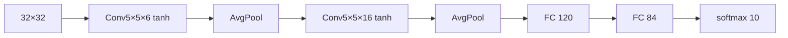
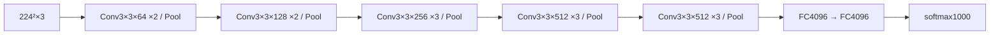
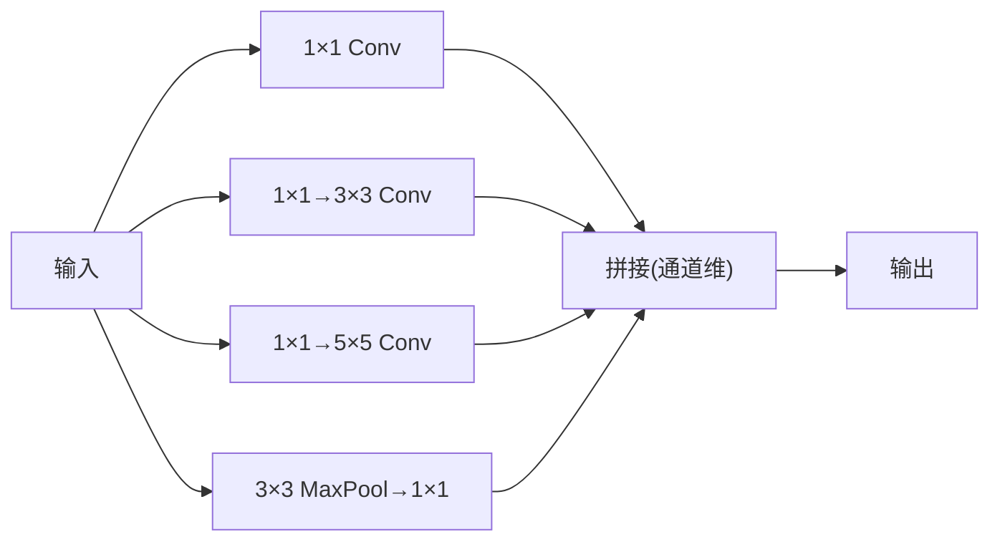
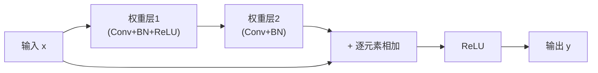
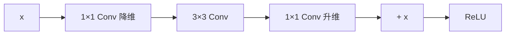
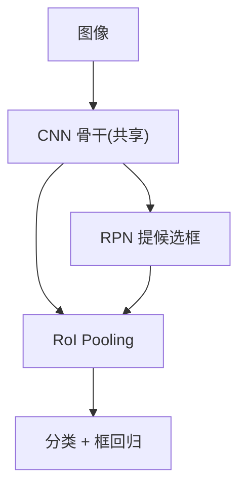
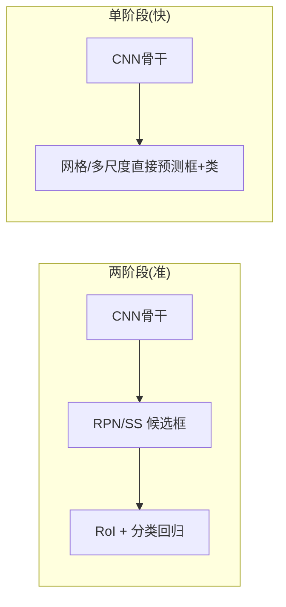

# 11 卷积神经网络（CNN）

> 来源：吴恩达 Deep Learning Specialization — Course 4（Convolutional Neural Networks）
> 重点：卷积操作、池化、经典网络结构、目标检测/分割、人脸识别、风格迁移。
> 本章尽量覆盖 Course 4 全部内容，并补充课程外的现代进展。

## 11.1 为什么不用全连接处理图像

- 全连接参数量爆炸：224×224×3 输入 → 接一层 4096 就上亿参数。
- 图像有两大先验：**局部性**（相邻像素相关）和**平移不变性**（物体在哪都该认得）。
- CNN 用**局部连接 + 权重共享**大幅减参，并天然利用这两点。

## 11.2 卷积（Convolution）

- 卷积核（filter / kernel）在输入上滑动，做**逐元素乘加**得到特征图（feature map）。
- 关键超参：
  - **kernel size**（如 3×3，现代主流；1×1 见 11.5）；
  - **stride**（步长，越大输出越小）；
  - **padding**（填充，"same" 保持尺寸 / "valid" 不填充）。
- 输出尺寸公式（方形、单方向）：
  $$n_{out}=\left\lfloor\frac{n_{in}+2p-f}{s}\right\rfloor+1$$
- **多输入通道 → 多输出通道**：一个卷积核在**所有输入通道**上做乘加后再求和，得到一个输出通道；放 $K$ 个这样的核 → $K$ 个输出通道。每个核参数量 $= f\times f\times C_{in} + 1$（偏置）。
- **权重共享**：同一核在整个图上滑动，参数只跟「核大小 × 输入通道数 × 输出通道数」有关，与输入空间尺寸无关 → 这是参数比全连接少几个数量级的原因。
- **参数量估算**（标准卷积）：$\#W = K\cdot (f\cdot f\cdot C_{in}+1)$（忽略偏置常数）。

### 11.2.1 卷积输出尺寸手算（实例）

输入 $5\times5$，卷积核 $3\times3$，`padding=1`，`stride=1`。

**尺寸**：套公式 $n_{out}=\lfloor(5+2-3)/1\rfloor+1=5$ → 输出仍为 $5\times5$（same padding 效果）。

**某个位置的值**（用原图左上 $3\times3$ 块，对应输出位置 $(1,1)$）：
$$X=\begin{bmatrix}1&2&3&0&1\\1&0&1&2&1\\2&1&0&1&2\\0&2&1&0&1\\1&0&2&1&0\end{bmatrix},\quad K=\begin{bmatrix}1&0&1\\0&1&0\\1&0&1\end{bmatrix},\quad X_{0..2,0..2}=\begin{bmatrix}1&2&3\\1&0&1\\2&1&0\end{bmatrix}$$

$$z_{1,1}=(1\cdot1+2\cdot0+3\cdot1)+(1\cdot0+0\cdot1+1\cdot0)+(2\cdot1+1\cdot0+0\cdot1)$$
$$=(1+0+3)+(0+0+0)+(2+0+0)=6$$

其余位置同理滑动计算。注意 padding=1 时边缘以 0 补齐，保证角点也能算出。

### 11.2.2 现代卷积变体（课程外拓展）
- **分组卷积（Grouped）**：把输入输出通道分组，各自独立卷积，参数量除以组数（AlexNet 双 GPU 起源，ResNeXt 发扬）。
- **深度可分离卷积（Depthwise Separable）**：先逐通道独立卷（depthwise），再 1×1 跨通道混合（pointwise）。参数量/算力大幅下降，是 MobileNet 的核心（见 11.4.6）。
- **空洞/膨胀卷积（Dilated）**：核元素间插 0，扩大感受野而不降分辨率，用于分割。
- **转置卷积（Transposed / 反卷积）**：上采样，用于分割/生成（Decoder、GAN）。
- **可变形卷积**：采样点位置可学习，适应几何形变（课程外）。

## 11.3 池化（Pooling）

- 在局部窗口取**最大（MaxPool）/ 平均**，降分辨率、提平移不变性、减计算。
- 通常不改变通道数，只缩小空间尺寸；输出尺寸同样用 11.2 公式（把核当窗口）。
- **全局平均池化（GAP）**：整张特征图池化成 1×1×C，直接接分类层（Network in Network / GoogLeNet 后常用，取代全连接、减参、抗过拟合）。
- 现代趋势：有时用 stride=2 的卷积代替池化来做下采样。

## 11.4 经典网络结构（逐个详述）

### 11.4.0 设计演进主线
LeNet（奠基）→ AlexNet（深度学习引爆）→ VGG（深而规整）→ Inception/GoogLeNet（多尺度并行）→ ResNet（残差解决退化）→ MobileNet/DenseNet（效率/信息流）。核心矛盾始终在「更深更准」vs「参数/算力可控」。

### 11.4.1 LeNet-5（1998, Yann LeCun）
- 任务：手写数字识别（MNIST）。
- 结构：输入 32×32 灰度 → (Conv 5×5, 6通道, tanh) → AvgPool → (Conv 5×5, 16) → AvgPool → 全连接 120 → 84 → softmax(10)。
- 贡献：**第一个成功商用的 CNN 范式**：卷积+池化+全连接堆叠；奠定「局部感受野 + 权值共享」。
- mermaid 示意：

### 11.4.2 AlexNet（2012, Krizhevsky et al.）
- 任务：ImageNet (ILSVRC 2012) 夺冠，Top-5 错误率从 ~26% 降到 ~15%，引爆深度学习。
- 结构（简化）：输入 227×227×3 → 多个 Conv(11×11/5×5/3×3)+MaxPool 交替 → 3 个 FC → softmax(1000)。
- 关键创新：
  - **ReLU** 取代 tanh（缓解梯度消失、训练更快）；
  - **Dropout** 防过拟合；
  - **GPU 并行**（模型分到两块 GTX 580）；
  - **数据增强 + 局部响应归一化 LRN**（LRN 现已少用）。
- 意义：证明「大数据 + 大模型 + GPU」能大幅超越传统 CV。

### 11.4.3 VGG（2014, Simonyan & Zisserman）
- 核心思想：**反复堆叠 3×3 卷积 + 2×2 MaxPool**，结构极简规整（VGG-16 / VGG-19）。
- 为什么用 3×3：两个 3×3 串联 = 一个 5×5 的感受野，但参数更少（$2\times3^2=18$ vs $5^2=25$）、非线性更多。
- 结构（VGG-16）：输入 224×224×3 → [Conv3×3×64 ×2 → Pool] → [×128 ×2 → Pool] → [×256 ×3 → Pool] → [×512 ×3 ×2 → Pool] → FC4096×2 → softmax1000。
- 代价：全连接层占参数量绝大多数（~90% 参数在 FC），后续被 GAP/1×1 替代。

### 11.4.4 GoogLeNet / Inception（2014, Szegedy et al.）
- 核心：**Inception 模块**——同一层并行跑 1×1、3×3、5×5 卷积和 3×3 MaxPool，再在通道维拼接，让网络**自己学多尺度特征**。
- **1×1 卷积的妙用**：在 3×3、5×5 前先 1×1 降维，控制计算量（见 11.5）。无 1×1 瓶颈版计算量巨大。
- 其他技巧：辅助分类器（中间层加 loss 防梯度消失）、**全局平均池化**取代全连接（大幅减参、抗过拟合）。
- 22 层却比 AlexNet 参数少得多。后续 v2/v3/v4 与 ResNet 结合（Inception-ResNet）。

### 11.4.1 ResNet 残差块（Skip Connection）

- 残差块学习**残差映射** $F(x)=H(x)-x$，输出 $y=F(x)+x$（skip 把 $x$ 直接加到输出）。
- **为什么能训很深**：反向传播时梯度有「高速公路」 $\frac{\partial y}{\partial x}=\frac{\partial F}{\partial x}+1$，恒等项 **+1** 保证梯度不随层数加深趋于 0（缓解梯度消失）；且 $F(x)\equiv0$ 时块退化为恒等映射，加深不损性能。
- 这正是 ResNet 能堆到 50/101/152 层甚至上千层的关键。

#### ResNet 两种块
- **BasicBlock**（ResNet-18/34）：两层 3×3。
- **Bottleneck**（ResNet-50/101/152）：1×1 降维 → 3×3 → 1×1 升维，用 1×1 控制 3×3 的计算量，深层主流。

### 11.4.6 MobileNet（2017, Howard et al.）—— 轻量高效
- 核心：**深度可分离卷积**（11.2.2）。标准卷积一次完成「空间滤波 + 跨通道混合」；它拆成两步：
  1. **Depthwise**：每个输入通道独立用 1 个 3×3 核滤波（不跨通道）；
  2. **Pointwise**：1×1 卷积做跨通道线性组合。
- 计算量对比：标准 $D_K^2\cdot C_{in}\cdot C_{out}\cdot D_F^2$ vs 可分离 $D_K^2\cdot C_{in}\cdot D_F^2 + C_{in}\cdot C_{out}\cdot D_F^2$，约降 $1/N + 1/D_K^2$（≈ 8–9× 于 3×3）。
- **宽度乘子 α / 分辨率乘子 ρ**：按比例缩放通道数与输入尺寸，在精度-延迟间权衡。
- MobileNetV2 引入 **Inverted Residual（倒残差）**：先 1×1 升维 → 深度卷积 → 1×1 降维 + skip，适配移动端。

### 11.4.7 DenseNet（2017, Huang et al.）
- 核心：**密集连接**——每一层接收前面**所有层**的特征图作为输入（通道维拼接），输出也传给后面所有层。
- 好处：特征复用、梯度路径极短（缓解消失）、参数效率高（窄通道即可）。
- 代价：特征图随层数线性增长（显存大），需 compression/transition 层降维。

### 11.4.8 经典网络对比表
| 网络 | 年份 | 深度 | 关键贡献 | 减参手段 |
|------|------|------|----------|----------|
| LeNet-5 | 1998 | ~7 | CNN 范式奠基 | 局部连接+权值共享 |
| AlexNet | 2012 | 8 | 深度学习引爆 | ReLU/Dropout/GPU |
| VGG | 2014 | 16/19 | 小核堆叠 | 3×3 串联 |
| GoogLeNet | 2014 | 22 | 多尺度并行 | Inception+1×1+GAP |
| ResNet | 2015 | 152+ | 残差连接 | skip connection |
| MobileNet | 2017 | 轻量 | 移动端实时 | 深度可分离卷积 |
| DenseNet | 2017 | 多 | 特征复用 | 密集连接 |

## 11.5 1×1 卷积的作用

- 跨通道的线性组合 + 降维/升维，参数量极少（$1\times1\times C_{in}\times C_{out}+1$）。
- Inception 里用来控制计算量（瓶颈层）；也可当「逐点全连接」做通道数调整。

## 11.6 目标检测（Detection，逐个展开）

### 11.6.1 目标定位（Classification + Localization）
- 在分类基础上额外回归**边界框** $(b_x,b_y,b_h,b_w)$（中心点 + 宽高，常相对网格归一化到 [0,1]）。
- 标签 $\mathbf{y}=[p_c, b_x, b_y, b_h, b_w, c_1,\dots,c_k]^T$：$p_c$ 表示「是否有目标」，无目标时只关心 $p_c=0$。
- 损失：有目标时框坐标用 MSE/Smooth-L1，类别用交叉熵，$p_c$ 用 logistic。

### 11.6.2 IoU（交并比）
- 预测框与真实框的**交集面积 / 并集面积**：
  $$\mathrm{IoU}=\frac{|A\cap B|}{|A\cup B|}\in[0,1]$$
- 常用阈值（如 IoU>0.5 算「命中」）评判定性指标。

### 11.6.3 非极大值抑制（NMS）
- 同目标会有多个重叠高置信框。步骤：
  1. 取最高分的框，保留；
  2. 删除与其 IoU 超过阈值（如 0.5）的其他框；
  3. 重复直到无剩余。
- 作用：每类只留一个最可信的框。

### 11.6.4 滑动窗口（Sliding Window）
- 暴力法：用固定窗口在图上滑过，每个位置跑一次分类器。
- 缺点：窗口多、算力爆炸、尺寸不灵活。
- **卷积化滑动窗口**：把全连接换成卷积，一次前向即得到所有位置结果（Yann LeCun 早年的 OverFeat 思想）。

### 11.6.5 两阶段检测
- **R-CNN**：先用**选择性搜索（Selective Search）** 提 ~2000 候选框 → 每个框 warp 后过 CNN 提特征 → SVM 分类 + 回归框。慢（每张图几千次前向）。
- **Fast R-CNN**：整图过 CNN 得特征图，候选框映射到特征图上（RoI Pooling）再分类/回归，**共享计算**，大幅加速。
- **Faster R-CNN**：用**区域提议网络（RPN）** 端到端学候选框（替代 Selective Search），RPN 在特征图上滑窗预测「锚框（anchor）」是否含目标及偏移。两阶段精度高、速度仍不及单阶段。

### 11.6.6 单阶段检测
- **YOLO（You Only Look Once）**：把图分成 $S\times S$ 网格，每格直接预测 B 个框的坐标/置信度 + 类别概率，**一次前向**出结果，速度极快、适合实时；后续 v2(v3/v4/v5…) 引入 anchor、多尺度、更好的 backbone。
- **SSD（Single Shot Detector）**：在**多个特征层**上预测不同尺度框（浅层抓小目标、深层抓大目标），兼顾速度与精度。
- 单阶段省去候选框阶段 → 更快，但早期精度/小目标弱于两阶段，后续版本已大幅缩小差距。

### 11.6.7 Anchor Boxes（锚框）
- 预定义一组不同尺度/比例的参考框；模型预测「相对锚框的偏移」而非绝对坐标，更稳定。
- 解决「一个格子多个物体」「尺度多样」问题；Faster R-CNN / YOLOv2+ / SSD 都依赖它。

### 11.6.8 mAP（mean Average Precision）
- 对每个类别算 PR 曲线下的 AP（Average Precision），再对所有类取平均 = mAP。
- 目标检测/实例分割的**主指标**；常报告 mAP@0.5（IoU 阈值 0.5）或 mAP@[0.5:0.95]（COCO 标准，更严格）。

## 11.7 语义分割（Segmentation）

- **FCN（全卷积网络）**：把全连接换成卷积，输出与输入同分辨率（或上采样回去）的逐像素类别图。
- **U-Net**：编码（下采样）—解码（上采样）对称结构，加**跳跃连接**把浅层细节喂回深层，医疗影像常用。
- **扩张卷积（Dilated）**：扩大感受野不丢分辨率（DeepLab）。
- **实例分割**：Mask R-CNN 在 Faster R-CNN 上加掩码分支，逐实例输出分割。

## 11.8 人脸识别与神经风格迁移（应用）

### 11.8.1 人脸识别
- 思路：学一个**嵌入（embedding）** 网络，把人脸图像映射到欧氏空间，同人距离近、异人距离远。
- **Siamese 网络**：两个共享权重的分支，输出嵌入后比距离。

#### Triplet Loss（三元组损失）推导
- 一个三元组：锚点 $A$、正样本 $P$（同人）、负样本 $N$（不同人）。
- 目标：$\|f(A)-f(P)\|^2 + \alpha < \|f(A)-f(N)\|^2$，即「正对距离 + 间隔 α < 负对距离」。
- 损失（只惩罚违规项）：
  $$\mathcal{L} = \sum_i \max\!\Big(0,\ \|f(A_i)-f(P_i)\|^2 - \|f(A_i)-f(N_i)\|^2 + \alpha\Big)$$
- $\alpha$ 为间隔超参，强制两类拉开；需难例挖掘（选最难的三元组）才训得动。

### 11.8.2 神经风格迁移（Neural Style Transfer）
- 输入：内容图 $C$、风格图 $S$；生成图 $G$ 同时逼近二者。
- **内容损失**：生成图与内容图在某高层特征图的欧氏距离：
  $$\mathcal{L}_{content} = \frac{1}{2}\|F^{[l]}(G)-F^{[l]}(C)\|^2$$
- **风格损失**：用** Gram 矩阵** $G^{[l]}_{ij}=\sum_k F^{[l]}_{ik}F^{[l]}_{jk}$（通道间的相关系数）刻画「风格」；风格损失是各层 Gram 差的加权：
  $$\mathcal{L}_{style} = \sum_l \frac{1}{(2N_l M_l)^2}\left\|G^{[l]}(G)-G^{[l]}(S)\right\|_F^2$$
- 总损失 $\mathcal{L} = \alpha_c\mathcal{L}_{content}+\alpha_s\mathcal{L}_{style}$，用梯度下降迭代更新 $G$ 的像素（不是更新权重！）。

## 11.9 实践要点

- 数据增强对 CNN 极重要（翻转、裁剪、色彩抖动、Mixup/CutMix）。
- 迁移学习：用 ImageNet 预训练 backbone 再微调（小数据集标配）；浅层学边缘/纹理，深层学语义，通常只微调后几层或加新头。
- 输入归一化到 [0,1] 或标准化（均值/方差，用训练集统计量）。
- 常用 backbone：ResNet / MobileNet / EfficientNet（课程外，复合缩放 width-depth-resolution，精度/算力更优）。
