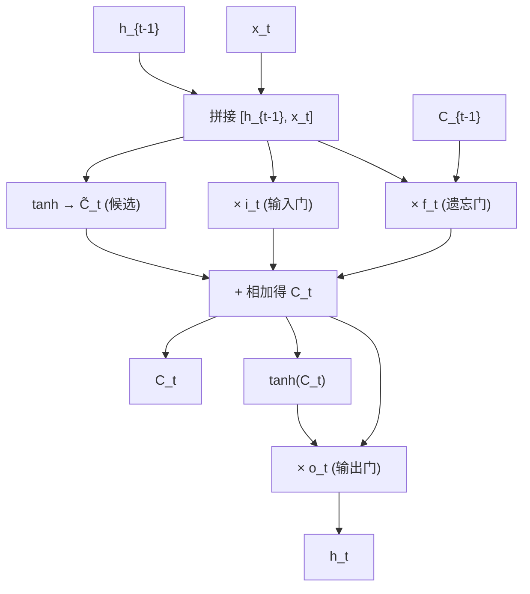
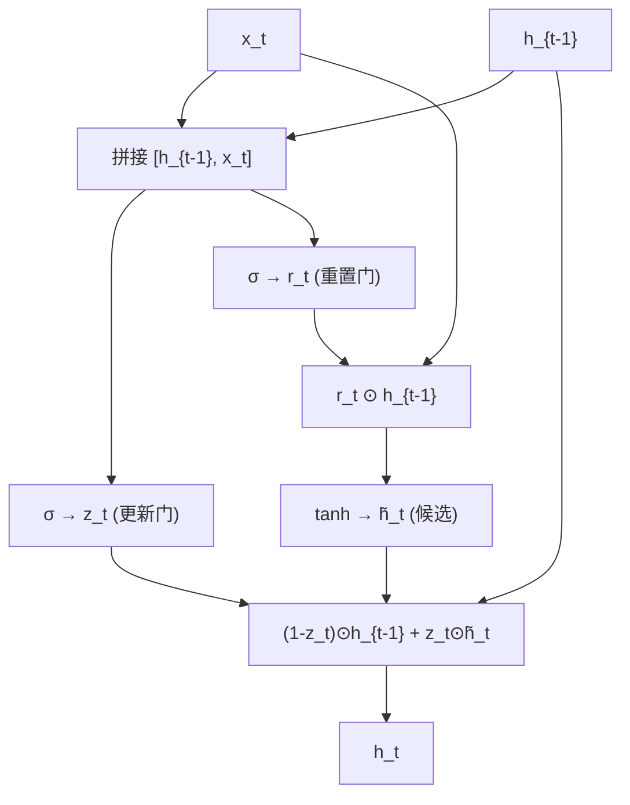
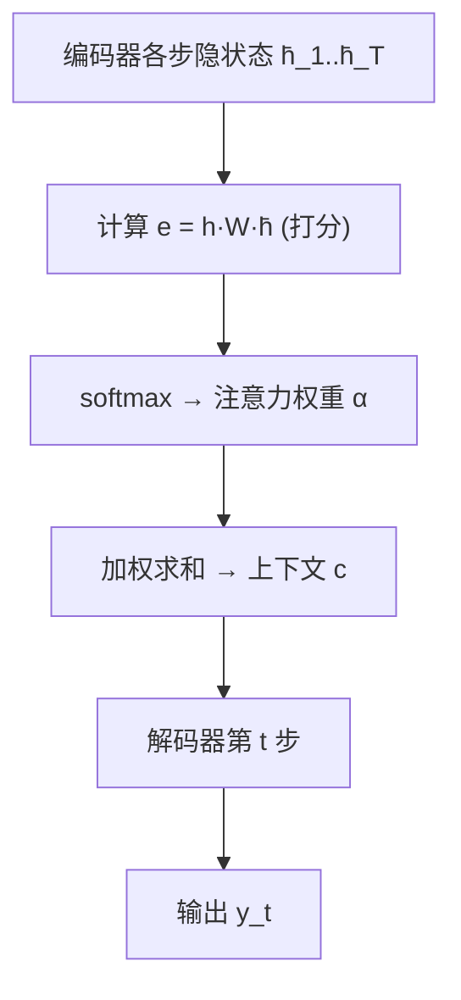
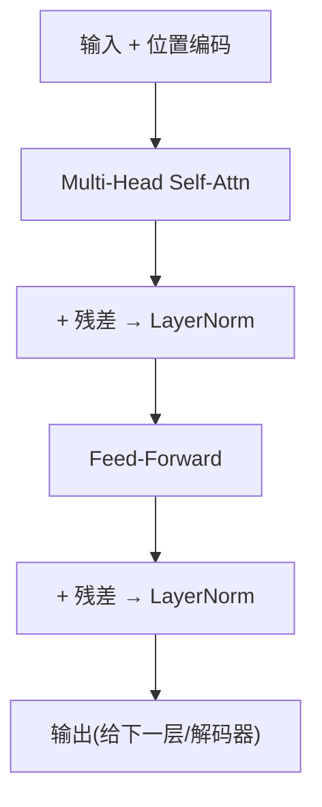

# 12 序列模型与注意力机制

> 来源：吴恩达 Deep Learning Specialization — Course 5（Sequence Models）
> 重点：RNN 家族、LSTM/GRU、词嵌入、Seq2Seq + 注意力、Transformer、典型应用。
> 本章尽量覆盖 Course 5 全部内容，并补充 Transformer / 大模型相关的现代知识。

## 12.1 序列数据的挑战

- 输入/输出长度**可变**（机器翻译、语音、文本）。
- 传统网络无法建模**时间依赖**和**顺序**；且不同样本长度不一、参数量难固定。
- 序列建模要同时解决「变长」与「长期依赖」两个问题。

## 12.2 循环神经网络（RNN）

### 12.2.1 基本形式
- 核心：隐状态在时间步间传递，$a^{\langle t\rangle}=g(W_{aa}a^{\langle t-1\rangle}+W_{ax}x^{\langle t\rangle}+b_a)$。
- 输出 $y^{\langle t\rangle}$ 由当前隐状态算出（如 softmax 分类或回归）。
- 参数 $W_{aa},W_{ax},W_{ya}$ **跨时间步共享** → 可处理变长序列、参数不随长度增长。

### 12.2.2 架构变体（按输入输出长度）
| 类型 | 输入→输出 | 例子 |
|------|-----------|------|
| 一对一 | 1→1 | 图像分类（不含序列） |
| 多对一 | 序列→1 | 情感分类、视频标签 |
| 一对多 | 1→序列 | 音乐生成、字幕生成 |
| 多对多（等长） | 序列→等长序列 | 命名实体识别 |
| 多对多（不等长） | 序列→序列 | 机器翻译、语音识别（Encoder-Decoder） |

### 12.2.3 反向传播随时间（BPTT）与梯度问题
- 展开成「深层」网络后做反向传播：梯度沿时间连乘 $\prod_t \frac{\partial a^{\langle t\rangle}}{\partial a^{\langle t-1\rangle}}$。
- **梯度消失**：多个 $<1$ 的因子（如 tanh/sigmoid 导数）连乘 → 前几步梯度≈0 → **长期依赖学不到**。
- **梯度爆炸**：连乘 >1 → 参数 NaN；对策：**梯度裁剪（gradient clipping）** 把梯度范数截断到阈值。
- 这是引入 LSTM/GRU 与注意力机制的动机。

## 12.3 LSTM 与 GRU（解决长依赖）

### 12.3.1 LSTM（长短期记忆）—— 完整公式

引入**门控**：遗忘门 $f$、输入门 $i$、输出门 $o$，以及**细胞状态 $C$**（信息高速通道）。记 $[h_{t-1},x_t]$ 为隐状态与输入的拼接，所有门用 sigmoid（$\sigma$），候选用 tanh：

$$f_t = \sigma(W_f[h_{t-1},x_t] + b_f)$$

$$i_t = \sigma(W_i[h_{t-1},x_t] + b_i)$$

$$\tilde C_t = \tanh(W_C[h_{t-1},x_t] + b_C)$$

$$C_t = f_t \odot C_{t-1} + i_t \odot \tilde C_t$$

$$o_t = \sigma(W_o[h_{t-1},x_t] + b_o)$$

$$h_t = o_t \odot \tanh(C_t)$$

- **遗忘门 $f_t$**：决定保留多少旧细胞记忆（$C_{t-1}$）；
- **输入门 $i_t$ + 候选 $\tilde C_t$**：决定写入多少新信息；
- **输出门 $o_t$**：决定当前细胞状态有多少暴露为隐状态 $h_t$；
- **细胞状态 $C$ 像「传送带」**：只有逐元素的乘加、几乎无矩阵乘法，可在多步间**近乎无损**流动 → 解决长依赖。
- 维度：$h_t,C_t\in\mathbb{R}^{n_h}$，$x_t\in\mathbb{R}^{n_x}$，$W_*\in\mathbb{R}^{n_h\times(n_h+n_x)}$。

### 12.3.2 GRU（门控循环单元）—— 完整公式

LSTM 的简化版：合并门控、**无独立细胞状态**（直接更新隐状态），参数更少、更快，效果常接近。

$$z_t = \sigma(W_z[h_{t-1},x_t] + b_z)$$

$$r_t = \sigma(W_r[h_{t-1},x_t] + b_r)$$

$$\tilde h_t = \tanh(W_h[r_t \odot h_{t-1}, x_t] + b_h)$$

$$h_t = (1 - z_t) \odot h_{t-1} + z_t \odot \tilde h_t$$

- **更新门 $z_t$**：在「保留旧隐状态」与「采用新候选」之间权衡（类似 LSTM 的 $f/i$ 合二为一）；
- **重置门 $r_t$**：控制旧隐状态对候选 $\tilde h_t$ 的影响，决定「遗忘多少过去」；
- 当 $z_t\approx0$ 几乎全用旧状态（长期记忆），$z_t\approx1$ 几乎全用候选（短期更新）。

> LSTM vs GRU 怎么选：没有绝对胜者；GRU 更轻更快、LSTM 表达力略强且门更多。资源紧/数据少常选 GRU，追求上限或已有 LSTM 管线则沿用 LSTM。

### 12.3.3 LSTM 单步前向（数值小例子）
标量演示：前一时刻 $a^{\langle t-1\rangle}=0.5,\ C^{\langle t-1\rangle}=0.3$，当前输入 $x^{\langle t\rangle}=0.2$。把 $[a^{\langle t-1\rangle},x^{\langle t\rangle}]=[0.5,0.2]$ 送入四个门（权重直接给出，便于计算）：

| 门 | 预激活 $z$ | 激活后 |
|----|-----------|--------|
| 遗忘门 $f=\sigma(W_f\!\cdot\![c])$ | $1\times0.5=0.5$ | $\sigma(0.5)=0.622$ |
| 输入门 $i=\sigma(W_i\!\cdot\![c])$ | $1\times0.2=0.2$ | $\sigma(0.2)=0.550$ |
| 候选 $\tilde C=\tanh(W_c\!\cdot\![c])$ | $0.5+0.2=0.7$ | $\tanh(0.7)=0.604$ |
| 输出门 $o=\sigma(W_o\!\cdot\![c])$ | $0.5-0.2=0.3$ | $\sigma(0.3)=0.574$ |

细胞状态与隐状态：
$$C^{\langle t\rangle}=f\odot C^{\langle t-1\rangle}+i\odot\tilde C=0.622\times0.3+0.550\times0.604\approx0.187+0.333=0.520$$
$$a^{\langle t\rangle}=o\odot\tanh(C^{\langle t\rangle})=0.574\times\tanh(0.520)\approx0.574\times0.477=0.274$$

> 遗忘门 $f=0.622$ 决定保留多少旧记忆（$0.3\times0.622\approx0.187$）；输入门 $i$ 决定写入多少新候选（$0.604\times0.550\approx0.333$）。细胞状态 $C$ 像「传送带」，可在多步间近乎无损流动 → 解决长依赖。

## 12.4 双向 RNN（BiRNN）与深度 RNN

- **双向**：同时从左→右和从右→左读序列，每时刻融合两个方向隐状态 $[\overrightarrow{h_t},\overleftarrow{h_t}]$。
- 适合「能看到整句话」的任务（如命名实体识别、情感分析）；**不能**用于实时/语言生成（未来信息不可用）。
- **深度 RNN**：每层是一个 RNN，把上一层的整条隐状态序列喂给下一层 → 多层堆叠加深表示。

## 12.5 词嵌入（Word Embeddings）

- 把词映射到稠密低维向量（如 300 维），语义相近的词向量也近（King − Man + Woman ≈ Queen）。
- **Word2Vec**：
  - **CBOW**：用上下文词预测中心词；
  - **Skip-gram**：用中心词预测上下文词。
  - 二者都用「正样本 + 负采样（Negative Sampling）/ 层次 softmax」高效训练。
- **GloVe**：基于全局词共现统计矩阵分解，目标含对数共现概率比。
- **fastText**：以子词（字符 n-gram）为单位，能处理未登录词（OOV）。
- 可视化：t-SNE / UMAP 把高维词向量降到 2D 观察语义簇。
- 迁移：预训练词向量用于小数据 NLP 任务；但现代主流已被上下文表示（ELMo/BERT）取代。
- **去偏（Debiasing）**：词向量会继承语料偏见（如性别），需用中和/均衡方向的方法消偏。

## 12.6 Seq2Seq 与注意力机制（Attention）

### 12.6.1 编码器-解码器（Encoder-Decoder）
- 编码器把变长输入压成上下文向量；解码器据此生成输出序列。
- 瓶颈：一个固定向量要装下整句信息（长句崩）→ 引出注意力。

### 12.6.2 注意力（Bahdanau / Luong）
- 解码每一步**动态关注**编码器不同位置，加权平均得到上下文 $c^{\langle t\rangle}$。
- 打分（Luong 点积）：
  $$e^{\langle t,t'\rangle} = (h^{\langle t-1\rangle})^T W_a\, \bar h^{\langle t'\rangle}$$
  $$\alpha^{\langle t,t'\rangle} = \mathrm{softmax}(e^{\langle t,t'\rangle})$$
  $$c^{\langle t\rangle} = \sum_{t'} \alpha^{\langle t,t'\rangle} \bar h^{\langle t'\rangle}$$
  - $\alpha$ 是「解码第 $t$ 步对编码器第 $t'$ 位置的注意力权重」，和为 1。
- 好处：缓解瓶颈、可解释（能看到解码时「看」了哪几个词）、显著改善长句翻译。
- Bahdanau 用隐状态隐式对齐，Luong 用点积/ concat 打分，本质一致。

## 12.7 Transformer 基础（承上启下，现代大模型根基）

### 12.7.1 为什么是 Transformer
- 完全基于**自注意力（Self-Attention）**，抛弃 RNN 的循环 → 可**并行**训练，长依赖直接连通（路径长度 O(1) vs RNN 的 O(n)）。
- 自注意力：序列内每个位置关注自己和其他所有位置，输出加权求和。

### 12.7.2 缩放点积注意力（Scaled Dot-Product Attention）
$$\mathrm{Attention}(Q,K,V) = \mathrm{softmax}\!\left(\frac{QK^T}{\sqrt{d_k}}\right)V$$
- $Q,K,V$ 分别由输入乘 $W^Q,W^K,W^V$ 得到；$\sqrt{d_k}$ 防止点积过大导致 softmax 梯度极小。
- 几何：对每个查询 $q$，用它与所有键 $k$ 的相似度做 softmax 得权重，再按权重搬运值 $v$。

### 12.7.3 多头注意力（Multi-Head）
$$\mathrm{head}_i = \mathrm{Attention}(QW_i^Q, KW_i^K, VW_i^V)$$
$$\mathrm{MultiHead}(Q,K,V) = \mathrm{Concat}(\mathrm{head}_1,\dots,\mathrm{head}_h)\,W^O$$
- 并行 $h$ 个注意力头，各看不同子空间（语法/语义/位置/远近），拼接后线性融合。
- **Self-Attention**：Q=K=V=同一序列（编码自身）；**Cross-Attention**：Q 来自解码器、K,V 来自编码器（翻译时「看源句」）。

### 12.7.4 位置编码（Positional Encoding）
- 因无循环，需额外注入位置信息。正弦方案：
  $$PE_{(pos,2i)} = \sin\!\left(\frac{pos}{10000^{2i/d_{model}}}\right)$$
  $$PE_{(pos,2i+1)} = \cos\!\left(\frac{pos}{10000^{2i/d_{model}}}\right)$$
- 绝对位置可线性外推、便于模型学相对位置；也可学习得到（learned embedding）。

### 12.7.5 编码器 / 解码器块结构
- **Encoder block**：Multi-Head Self-Attn → **Add & LayerNorm** → Feed-Forward → Add & LayerNorm。
- **Decoder block**：Masked Multi-Head Self-Attn → Add&Norm → Cross-Attn(到编码器输出) → Add&Norm → Feed-Forward → Add&Norm。
- **Feed-Forward（FFN）**：$FFN(x)=\max(0, xW_1+b_1)W_2+b_2$（逐位置独立的两层 MLP）。
- **残差 + LayerNorm**：每子层外包残差连接与层归一化，稳定深层训练。

### 12.7.6 训练 vs 推理 / Masking
- **因果掩码（Causal Mask）**：解码器自注意力用上三角掩码，保证第 $t$ 步只看 ≤$t$ 的位置（不能偷看未来）。
- **训练用 Teacher Forcing**：解码器输入喂入真实目标（而非自己上一步预测），加速收敛。
- **推理用自回归**：一步步生成，上一步输出作下一步输入；用**束搜索（Beam Search）** 而非贪心，保留 top-k 候选序列。
- 复杂度：自注意力 $O(n^2 d)$，RNN $O(n d^2)$；当 $n$（序列长）很大时注意力更占优且可并行。

### 12.7.7 后续演化（课程外拓展）
- **BERT**（Encoder-only）：掩码语言模型（MLM）预训练，擅长理解/分类/抽取。
- **GPT**（Decoder-only）：自回归生成，ChatGPT/LLM 的基础。
- **编码器-解码器**：T5、BART（翻译/摘要/生成）。
- 这些是「大模型」的根，建议单独延伸笔记（可加 `13-Transformer与大模型深入.md`）。

## 12.8 典型应用

- **机器翻译**：Seq2Seq + 注意力 → Transformer。
- **文本生成 / 语言模型**：预测下一个词，自回归生成（见 12.7.7）。
- **语音识别（ASR）**：音频帧序列 → 文字；常用 **CTC** 损失处理输入输出不对齐。
- **音乐生成**：音符序列自回归生成。
- **DNA / 蛋白质序列分析**：把序列当「语言」建模（如 AlphaFold 用到注意力）。
